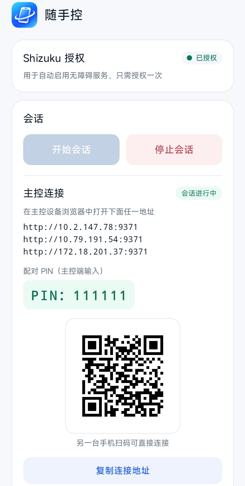

# 随手控


把一台 Android 手机变成被控端：手机安装 APK 并点「开始会话」后，用电脑或另一台设备的浏览器打开网页，输入 6 位 PIN 就能实时看屏并操作。

主控端免安装、免账号；手机端只在会话期间开放服务，结束后立即关闭并还原设置。



## 功能

- **实时画面**：MediaProjection 采集 + MediaCodec 硬编码 H.264，浏览器通过 MSE / JMuxer 播放
- **触控与按键**：点击、滑动、长按、多指，返回 / 主页 / 最近任务，鼠标滚轮
- **文字输入**：Shizuku 可用时走系统级注入，否则用无障碍粘贴，支持中文
- **画质四档**：流畅 / 均衡 / 高清 / 原画，编码跟不上时自动降档
- **文件互传**：多选、文件夹、分片下载、断点续传、暂停与取消
- **剪贴板同步**：双向同步与历史记录
- **独立窗口**：电脑上可自由拖拽缩放，随被控端横竖屏自动对调
- **三种连接**：局域网直连、虚拟局域网、自建中继
- **端到端加密**：PIN 派生密钥，AES-256-GCM；中继只见密文

## 环境要求

- **被控手机**：Android 8.0 及以上
- **主控端**：支持 Media Source Extensions 的现代浏览器，建议 Chrome / Edge
- **中继**：Node.js 16 及以上（仅自建中继时需要）

## 快速开始（局域网）

### 1. 安装

1. 被控手机安装随手控 APK，允许通知权限。
2. 安装 [Shizuku](https://github.com/RikkaApps/Shizuku/releases)，用于自动启用无障碍服务。

### 2. 授权

1. 打开 Shizuku，按引导打开开发者选项 → 无线调试 → 使用配对码配对，输入配对码。
2. 在 Shizuku 里为随手控授权。只需授权一次。

### 3. 开始会话

1. 打开随手控，确认「Shizuku 授权」显示已授权。
2. 点「开始会话」，允许屏幕录制。
3. 手机页面会显示访问地址、6 位 PIN 和二维码。
4. 主控端用同一 Wi-Fi 打开地址（或另一台手机扫码），输入 PIN 连接。

## 异地使用

### 方式 A：虚拟局域网

EasyTier、蒲公英、Tailscale 等均可，原理相同：两端加入同一虚拟网络，被控手机获得虚拟 IP，主控打开 `http://虚拟IP:9371` 即可。需要确保两端能成功 P2P 打洞。

### 方式 B：自建中继

要求：Node.js 16+、公网可达、放行 TCP 8787（`PORT` 可修改）。

```bash
cd relay-server
npm install
node relay.js
```

手机上的「连接方式」选「中继服务器」，填写 `服务器IP:8787`。开始会话后，屏幕会显示带房间号的地址和 PIN，主控直接打开。

中继只转发密文。带宽是主要瓶颈：中继需要把视频收进来再发出去，原画约 16 Mbps / 会话；带宽有限时把画质切到高清或均衡。HTTPS 反代、常驻部署与打包见 [开发与发布](docs/开发与发布.md)。

## 安全

- PIN 只在握手阶段出现，之后双方使用 `PBKDF2(PIN, 会话盐, 200000 轮)` 派生的密钥加密。
- 画面、触控、剪贴板始终加密；文件传输默认加密，只有直连模式可以手动关闭。
- PIN 错误 6 次拉黑来源 IP；会话结束后 HTTP / WebSocket 服务立即关闭，外部无法再连接。
- 中继服务器只能看到密文，无法看到屏幕、指令或文件内容。
- 6 位 PIN 的熵有限，适合个人 / 家庭场景。公网使用建议配合 HTTPS 反代，并在源码 `Pref.pin` 处加长 PIN。

## 已知限制

- 不传输声音。
- 浏览器通过 http 访问时没有 WebCodecs 与 WebCrypto，网页使用纯 JS 加密回退，延迟下限由「编码 + MSE 缓冲」决定。
- 浏览器不允许网页去掉独立窗口的地址栏，也不允许自动进入全屏。
- 部分国产系统会把输入法窗口标记为安全窗口，投屏中显示为黑块，但不影响实际输入。
- 6 位 PIN 不适合直接暴露在公网；公网部署请配合 HTTPS 和更长口令。

## 文档

- [开发与发布](docs/开发与发布.md)：构建、签名、自检、中继打包、第三方组件、许可与署名
- [设计说明](docs/设计说明.md)

## 许可证

[MIT](LICENSE) © 2026 jiangee02

## 免责声明

本项目仅供个人远程协助、自用设备管理等合法用途。请只操作你拥有或已获得明确授权的设备，不得用于监控他人、绕过设备安全策略或其他违法用途。公网或中继部署涉及的网络、数据与合规风险由使用者自行承担。
